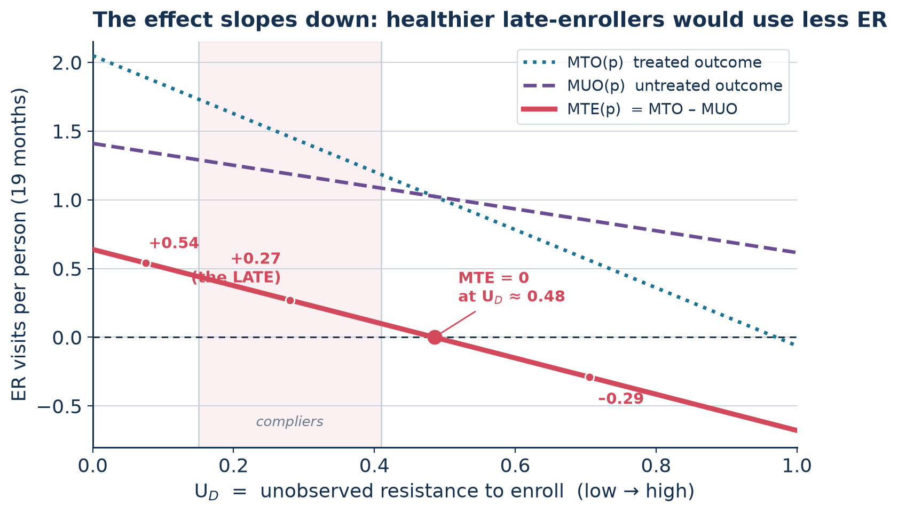
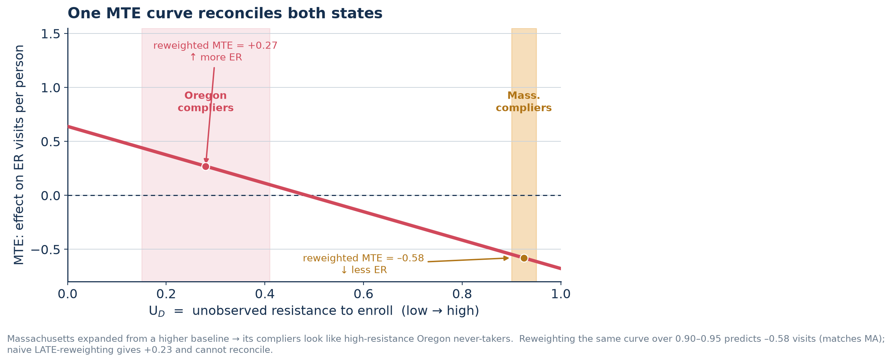
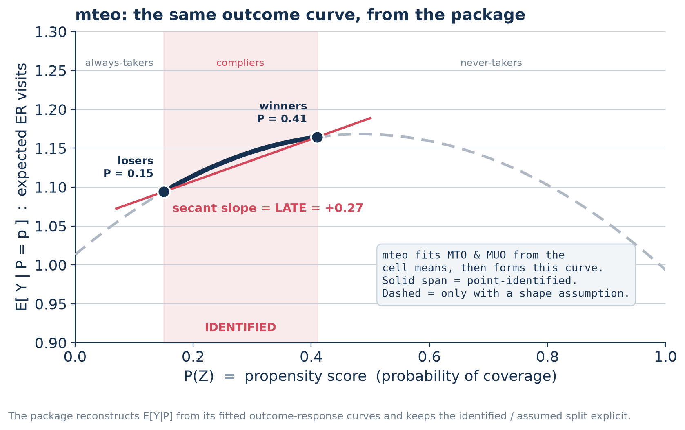
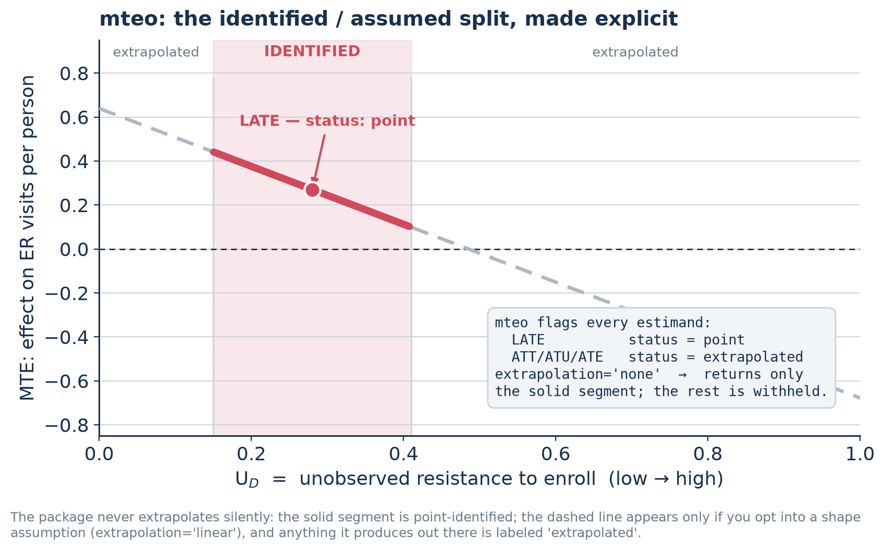

# mteo

`mteo` estimates marginal treatment effects (MTE) and marginal treated/untreated
outcome functions (MTO/MUO) for randomized experiments with imperfect take-up —
the binary-instrument framework of Kowalski (2023, *Review of Economics and
Statistics* 105(3), "Reconciling Seemingly Contradictory Results from the Oregon
Health Insurance Experiment and the Massachusetts Health Reform") and Brinch,
Mogstad & Wiswall (2017, *Journal of Political Economy*, "Beyond LATE with a
Discrete Instrument"). As of this writing it is the first publicly available
implementation of this binary-instrument MUO/MTO framework — a complement to,
not a port of, R's `ivmte` (which uses a different, moment/bounds approach).

**The method is Amanda E. Kowalski's.** This package implements the estimator
from Kowalski (2023) and Brinch, Mogstad & Wiswall (2017); it is an independent
open-source implementation, not affiliated with or endorsed by those authors.
If you use it, cite the papers (see [Credit and references](#credit-and-references)).

The payoff over a plain LATE is that it tells you not just the average effect on
the people a nudge moved into treatment, but **how the effect and the selection
into treatment vary across the population** — and it keeps the line between what
the experiment identifies and what only a shape assumption extrapolates explicit
at every step.

## A worked example: two experiments, opposite signs

The framework's motivating case (Kowalski 2023). Two credible randomized studies
of health-coverage expansion reached opposite conclusions about emergency-room
use: Oregon's 2008 Medicaid lottery found winning coverage *raised* ER use
(+0.27 visits per complier over 19 months), while the Massachusetts 2006 reform
*lowered* it. A single marginal-treatment-effect curve reconciles them.

Model enrollment with a latent index — a unit takes up treatment iff its
unobserved resistance `U_D` falls below a propensity `p` (Heckman–Vytlacil). The
Oregon lottery lifts `p` from 0.15 (losers) to 0.41 (winners); the gap is the
compliers. Tracing the treated and untreated outcomes as functions of `p` gives
the MTO and MUO curves, and their difference is the MTE.



Two findings fall out. **Selection is real and adverse**: compliers' untreated
ER use (1.19) exceeds never-takers' (0.85) by 0.34 (SE 0.13) — the people the
lottery moves are sicker, so they gain more ER use from coverage. **The effect is
heterogeneous and crosses zero**: the MTE falls from +0.54 among the least
resistant to −0.29 among the most, crossing zero at `U_D ≈ 0.48`. The Oregon LATE
(+0.27) is just the average of this curve over the complier span — one point on a
line, not a universal constant.

That is what reconciles the two states. Massachusetts expanded coverage from an
already-high 89% baseline, so its compliers sit far out at `U_D ≈ 0.90–0.95` —
healthier, higher-resistance people who resemble Oregon's never-takers. Reweight
the *same* Oregon MTE curve over that margin and it predicts −0.58 visits, matching
the Massachusetts decline. Naive LATE-reweighting gives +0.23 and cannot reconcile
them.



This is an illustrative reproduction — stylized linear MUO/MTO annotated with
Kowalski's reported statistics, not a fit to raw microdata — and the reweighting
to the Massachusetts margin rests on linearity (AA.1) and on extrapolating well
beyond Oregon's identified 0.15–0.41 complier span, which `mteo` flags as such.

## Install

```bash
pip install -e .
```

Requires Python >= 3.12; depends on numpy, pandas, scipy, matplotlib.

## Quickstart

```python
import mteo
from mteo.dgp import RoyDGP

dgp = RoyDGP()                 # two-sided noncompliance, linear MUO/MTO truth
df = dgp.sample(20_000, seed=0)

result = mteo.fit(df, outcome="y", treatment="d", instrument="z",
                   extrapolation="linear", bootstrap_reps=200, seed=0)

print(result.summary())        # LATE, tests, ATT/ATU/ATE with statuses
result.plot()                  # the Kowalski MUO/MTO figure
```

## What the package produces

`mteo` reconstructs the outcome-vs-propensity picture from its fitted MTO/MUO
cell means and keeps the identified span separate from the extrapolated one. The
two arm means are the only points the experiment pins down; the secant between
them is the LATE, and the curve's slope is the MTE.



The guarantee that distinguishes this estimator from a curve-fitting exercise:
**nothing is extrapolated silently.** With `extrapolation="none"` (the default)
the package returns only the point-identified segment and withholds the rest;
every estimand it reports is tagged `identified` or `extrapolated`, so a reader
can always tell a fact from an assumption.



## API

`mteo.fit(data, outcome, treatment, instrument, strata=None, extrapolation="none", poly_order=None, bootstrap_reps=1000, cluster=None, weights=None, seed=None, monotone_direction=None, outcome_bounds=(-inf, inf), min_take_up_gap=0.02) -> MTEOResult`

| argument | meaning |
|---|---|
| `outcome`, `treatment`, `instrument` | column names; treatment and instrument must be binary 0/1 |
| `strata` | optional column of stratum labels supplying extra propensity points (BMW covariate variation) |
| `extrapolation` | `"none"` (default, never extrapolates), `"linear"` (AA.1 shape restriction), or `"bounds"` (weak-monotonicity bounds) |
| `poly_order` | curve order; default `min(1, #propensity points - 1)`. An explicit value above `#points - 1` raises `IdentificationError` (never silently reduced) |
| `bootstrap_reps` | number of nonparametric bootstrap reps re-running the whole pipeline (default 1000; **note:** this is the real keyword — the shipped API is `bootstrap_reps=`) |
| `cluster` | optional column to cluster the bootstrap resampling on |
| `weights`, `seed`, `monotone_direction`, `outcome_bounds`, `min_take_up_gap` | sampling weights, RNG seed, `{"mto": ..., "muo": ...}` directions for bounds mode, outcome support for bounds, and the thin-take-up-gap warning threshold |

`MTEOResult` fields: `.groups` (take-up rates, shares, LATE), `.mto` / `.muo`
(fitted `Curve` or `None`), `.tests` (`.selection`, `.treated_selection`,
`.bmw`, `.mte_slope`, `.overid`, each a `TestStat` with `.stat`/`.se`/`.ci`, or
`None` when not identified — see `.tests.reasons`), `.estimands` (dict of
`late`/`att`/`atu`/`ate` `Estimand` objects with `.status`, `.value`,
`.bounds`), `.boot` (bootstrap SEs/CIs or `None`), `.summary()`, `.plot(ax=None)`,
`.predict_late(p_lo, p_hi)`.

## Identification cheat-sheet

| quantity | identified under LATE assumptions alone | needs AA.1 (linear) or bounds |
|---|---|---|
| Group shares (always/complier/never-taker) | yes | — |
| LATE (complier treated − complier untreated mean) | yes | — |
| Untreated-outcome selection test | yes | — |
| Treated-outcome selection test, BMW Δ₁=Δ₀ test | yes, but only two-sided designs (needs always takers) | — |
| ATT | yes if one-sided (ATT = LATE); two-sided needs AA.1/bounds | two-sided: yes |
| ATU, ATE, `predict_late` outside complier support | no | yes |
| MTO curve under one-sided noncompliance | no — only one propensity point (complier) is identified | needs strata for extra propensity points, even under AA.1 |

`extrapolation="none"` is the default and never extrapolates silently; requests
for unidentified quantities raise `IdentificationError` or (for `Estimand`)
report `status="not_identified"` with a `.reason`.

## Further reading

- `docs/use_cases.md` — where this framework adds value over ITT/LATE/CATE.
- `notebooks/methods_walkthrough.ipynb` — `RoyDGP` walkthrough, extrapolation,
  and the misspecification-honesty demo.
- `notebooks/one_sided_takeup.ipynb` — one-sided-noncompliance vignette:
  naive-vs-IV comparison, strata for extra propensity points, `predict_late` at
  an expansion margin.

## Limitations

v1 supports a single **binary** randomized instrument only — no continuous
instruments, no observational/endogenous-treatment modes (those are keyed
off the same p(U) internals and are natural future work, not implemented
here). Partial-identification bounds under weak monotonicity use only
**adjacent identified-cell** averages and user-supplied outcome bounds; Kowalski
found these bounds uninformative in her own application and used the linear
AA.1 assumption instead, so expect wide, often-uninformative bounds unless you
supply tight `outcome_bounds`. ATT/ATU/ATE are Kowalski's **uniform-weight MTE
integrals over the U_D intervals** (ATT over `(0, p_I]`, ATU over `(p_C, 1]`,
ATE over `(0, 1]`) — the MTE-reweighting parameters the estimator actually
targets, not the classical conditional-on-treatment-status effects (e.g. ATU
is not `E[MTE | D=0]`); see `docs/use_cases.md` for why this distinction
matters. There is no numerical cross-validation yet against Kowalski's Stata
modules (`mtemore`/`mtebinary`), which requires a Stata license and is
recorded as future work.

## Credit and references

The identification framework and estimator implemented here are due to **Amanda
E. Kowalski** and to **Christian Brinch, Magne Mogstad & Matthew Wiswall**. This
is an independent open-source implementation; it is not affiliated with,
reviewed by, or endorsed by those authors. The worked example above reproduces
the published Oregon/Massachusetts reconciliation from Kowalski (2023) and is
annotated with the statistics reported there.

- Kowalski, Amanda E. (2023). "Reconciling Seemingly Contradictory Results from
  the Oregon Health Insurance Experiment and the Massachusetts Health Reform."
  *Review of Economics and Statistics* 105(3): 646–664. (NBER Working Paper
  w24647.)
- Brinch, Christian N., Magne Mogstad & Matthew Wiswall (2017). "Beyond LATE
  with a Discrete Instrument." *Journal of Political Economy* 125(4): 985–1039.
- Heckman, James J. & Edward Vytlacil (2005). "Structural Equations, Treatment
  Effects, and Econometric Policy Evaluation." *Econometrica* 73(3): 669–738.

Underlying empirical results on the Oregon Health Insurance Experiment that
Kowalski (2023) builds on include Finkelstein et al. (2012) and Taubman et al.
(2014); the Massachusetts estimate is from Miller (2012).

## License

MIT — see [LICENSE](LICENSE).
