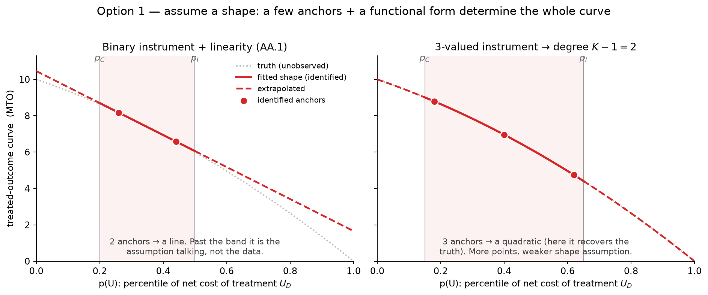
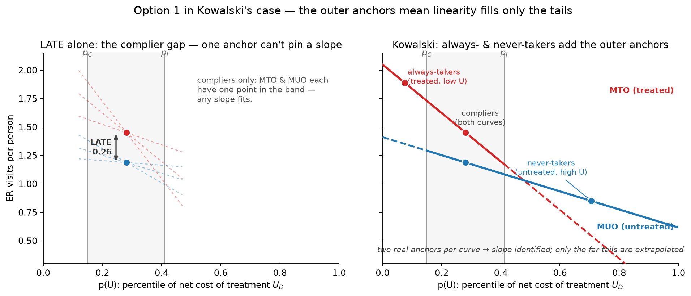

# Use cases

Where the MUO/MTO framework adds value over intention-to-treat (ITT), a plain
LATE, or a conditional average treatment effect (CATE) model — and where it
does not apply.

A note on notation before the use cases: `mteo`'s ATT, ATU, and ATE are
**Kowalski's uniform-weight MTE integrals over the U_D intervals** — ATT
averages the marginal treatment effect MTE(p) over `(0, p_I]` with weight
`1/p_I`, ATU over `(p_C, 1]` with weight `1/(1-p_C)`, and ATE over `(0, 1]`
with weight `1`. These are the parameters the separate-approach estimator
actually targets and reports an identification status for. They are **not**
the classical conditional-on-treatment-status effects: `mteo`'s ATU is not
`E[MTE(U) | D=0]`, because never-takers are not uniformly distributed in
`U_D` — they occupy `(p_I, 1]` but the classical ATU conditions on the whole
`D=0` population (always- and never-takers are disjoint from compliers, but
the *within-group* distribution of `U_D` need not be uniform once you
condition on an observed group rather than integrate over an interval).
Read every ATT/ATU/ATE from this package as "the MTE-reweighted average over
this margin," not as "the average effect on people who are/aren't treated."

## Diagnosing selection into treatment

The untreated-outcome selection test (`result.tests.selection`) is
identified from LATE assumptions alone — no shape restriction, no
extrapolation. It compares `E[Y_U | complier]` to `E[Y_U | never taker]`:
the untreated outcome of the units the instrument *does* move into treatment
versus the untreated outcome of the units it never moves. Because `Y_U` is
the untreated potential outcome, treatment cannot be driving any difference
you find — a nonzero statistic is baseline selection, full stop.

In plain terms, this answers "do the units the instrument moves differ, before
any treatment touches them, from the units it never moves?" That is a question
about who selects into treatment, not about what treatment does to anyone. ITT
cannot answer it: ITT averages over compliers and never-movers together and
mixes selection with effect. A CATE model fit on observed treatment status
faces the reverse problem — it can show treated and untreated units differ on
outcomes, but because take-up is endogenous (driven by the same `U_D` that may
also predict the outcome), it cannot separate "treatment changed their
trajectory" from "the units that take up were always going to look different."
The untreated-outcome test isolates the second piece cleanly, using only the
randomized instrument.

## Expansion decisions via `predict_late`

`result.predict_late(p_lo, p_hi)` reweights the fitted MTE curve to the
subpopulation with `U_D` in `(p_lo, p_hi]` — a different margin than the
LATE the RCT identified. This is the tool for "if we expand treatment to
reach more units, what effect should we expect on the newly-reached
group?" The newly-reached group is not a random sample of current
compliers: it is drawn from `U_D` just above the current `p_I`, i.e. units
that resisted take-up at the current level of encouragement and would only
take up under a stronger push. Kowalski's own motivating exercise — using
one experiment's identified MTE curve to predict outcomes for a
population defined by a different program's take-up margin (the paper's
Oregon/Massachusetts reconciliation) — is the precedent for this kind of
out-of-sample-margin reweighting.

Two caveats travel with every `predict_late` call away from the identified
complier range. First, `mteo` only extrapolates when you ask for it
(`extrapolation="linear"` at `fit()` time, or implicitly whenever `p_lo`/`p_hi`
fall outside the fitted curve's identified span) — the returned `Estimand`
reports `status="extrapolated"` so you can tell the difference from a
point-identified prediction. Second, any prediction outside the complier
support depends on AA.1 (linear MUO/MTO) holding on the new margin, which is
untestable there by construction; the overidentification test only checks
linearity on the range strata make identified, not beyond it. Treat expansion
predictions as "our best linear extrapolation, flagged as such," not as
another point estimate with the same footing as the LATE.

## Interpreting OLS-vs-IV gaps

A common diagnostic question: why does a naive OLS/regression comparison of
treated vs. untreated units show a much bigger (or smaller, or
sign-flipped) gap than the IV/LATE estimate? The gap between the two has two
possible sources, and the MUO/MTO decomposition is what separates them.
**Selection heterogeneity**: treated and untreated units differ at
baseline (captured by the untreated-outcome selection test above), so the
naive comparison bakes in a selection effect that IV, by design, purges.
**Effect heterogeneity**: the treatment effect itself varies across the
population (captured by `result.tests.mte_slope`, the treated-vs-untreated
selection contrast, and the BMW Δ₁=Δ₀ external-validity test), so even a
selection-free estimate at one margin (the LATE) need not generalize to the
ATE or to a different margin.

Running both tests tells you which story to reach for. A large selection
statistic with a flat MTE slope says the OLS/IV gap is almost entirely who
takes up, not what treatment does to them — the LATE likely generalizes
reasonably to nearby margins. A near-zero selection statistic with a large
MTE slope says the reverse: selection isn't the story, but the effect itself
is heterogeneous, and the LATE from this experiment may not represent the ATE
or a different program's margin. Seeing both large is the case that most needs
the full curve rather than any single scalar summary.

## Reaching past the margin the experiment anchors

Every quantity above is only as identified as the data make it, and a binary
instrument anchors the outcome curves at only a handful of `U_D` points. How
many you get is a property of the compliance structure, not a choice — the
ladder runs from barely identified to fully anchored:

- **Perfect compliance** (everyone assigned takes up, no one else can reach the
  program): the whole sample is compliers, so there is one anchor and one
  number — the ATE, equal to the LATE. With no second point on either curve
  there is no slope and no selection signal; `result.tests.mte_slope` and the
  treated-side selection contrast are not identified.
- **One-sided noncompliance** (the control arm cannot take up, so there are no
  always-takers — `summarize_groups` sets `one_sided` when no `D=1, Z=0` cell
  exists): the LATE equals the ATT, and the untreated curve (MUO) is anchored by
  compliers and never-takers. But the treated curve (MTO) has a single anchor,
  so its slope is not identified from cell means. `mteo` makes the refusal
  explicit rather than fabricating a flat line — `fit` leaves `result.mto = None`
  and raises *"linear MTO not identified from a single propensity point; provide
  strata"* if asked to extrapolate anyway.
- **Two-sided with interior take-up in both arms**: always-takers anchor MTO at
  low `U_D`, never-takers anchor MUO at high `U_D`, compliers anchor both in the
  middle — two points per curve, so under AA.1 both lines (and ATT, ATU, ATE,
  and the full selection test) are identified.

When you are on the first two rungs and still need the part of the curve the
experiment did not reach, there are three ways forward, and each pays for the
reach in a different currency. Naming the currency is the honest part, and it is
the thing a cell-means estimator cannot do for you.

### Option 1 — assume a shape

Impose a functional form so a few anchors pin the whole curve. A binary
instrument plus linearity (AA.1) turns two anchors into a line
(`extrapolation="linear"`); a `K`-valued discrete instrument identifies a
degree-`K-1` polynomial (Brinch–Mogstad–Wiswall 2017) — three take-up values
buy a quadratic, and so on.

The currency is *functional form*: everything outside the anchored band is the
assumption talking, not the data (left panel). `mteo` tags those estimands
`status="extrapolated"`, and when strata leave more cells than the polynomial
has coefficients it spends the surplus on an overidentification (linearity) test
rather than a free fit. What it will not do is invent a slope from a single
anchor — that is the one-sided `MTO = None` case above. More points weaken the
assumption (right panel): with enough take-up values you *estimate* the
curvature instead of imposing it, which is exactly Option 2.

How much the shape assumption has to carry depends on the design. The figure
above is the lean case — anchors only inside the complier band, as in one-sided
noncompliance, where linearity (or a polynomial) is responsible for the entire
curve outside `[p_C, p_I]`. A *two-sided* binary design is better anchored than
that: the always-takers reveal a treated-outcome anchor below `p_C` and the
never-takers an untreated-outcome anchor above `p_I`, so each curve already has
two real anchors spanning a wide range of `U_D`, and linearity extrapolates only
the far tails. This is Kowalski's Oregon case (ER visits, the published paper):

The left panel is the complier-only view: one anchor per curve pins the LATE
(the gap between MTO and MUO in the band) but not a slope — through a single
point, any slope fits. The right panel adds the always-takers (a treated-outcome
anchor at low `U_D`) and the never-takers (an untreated-outcome anchor at high
`U_D`); with a second real anchor per curve the slope is identified *from data*
as the difference of the two line-slopes, and only the far tails past the
outermost anchors rest on the linearity assumption. That is why a two-sided
binary design recovers ATT, ATU, ATE, and the full selection test, while the
one-sided design — missing the always-taker anchor — leaves MTO under-anchored
and returns `MTO = None` until strata supply the missing points (Option 2).

### Option 2 — manufacture more propensity points

Turn one binary contrast into many take-up rates so you trace curvature instead
of assuming it. Build a take-up-propensity model from a covariate-rich feature
set, cut the sample into strata whose take-up rates differ, and pass them as
`fit(..., strata=...)`. Each stratum's complier interval sits at a different
place on the `U_D` axis, so stacking strata yields anchors spread across the
axis (`summarize_strata`): `K` cells identify a degree-`K-1` curve, and surplus
cells give a weighted-least-squares fit plus the overidentification test. In the
one-sided design this is not a luxury but the *only* route to the treated curve
— strata with different take-up rates supply the extra MTO anchors a single arm
cannot, which is why `fit` points you to `strata` precisely when MTO is
otherwise `None`.

The currency here is an **exclusion (index-sufficiency) restriction on the
strata**: every stratum must share the same `MTE(u)` — the stratifying
covariates may shift *who takes up and at what rate* (the propensity) but must
not shift the *outcome at a given `U_D`* (the effect). Conditional on the
propensity, the covariates are excludable. Miss that — build the strata from
covariates that also move the outcome — and the extra anchors are contaminated:
you have reintroduced the selection-on-observables the instrument was there to
purge, and cross-stratum pooling is biased (the package's own `dgp` notes that
non-excludable strata break within-stratum `U` uniformity, and hence pooling).
Strata widen identification *only* under that restriction, never for free — but,
unlike Option 1's two-point linearity, the restriction leaves a testable
footprint in the cross-stratum overidentification test.

A flexible, high-dimensional take-up model is the natural way to build good
strata and good common support, and the natural next layer is **cross-fitted
double/debiased ML (DML)** for the propensity and outcome nuisances, so
first-stage regularization error does not leak into second-stage MTE inference
(Neyman-orthogonal moments, out-of-fold fitting). This is a roadmap direction,
not a v1 feature — `mteo` v1 is the BMW separate-approach over strata and does
not cross-fit — but the `strata` hook is where that extension attaches. Two
cautions travel with it: strata help only where they actually *move* take-up
(equal take-up across strata adds rows, not identification — the
`min_take_up_gap` guard and `WeakInstrumentWarning` watch for this), and you are
trading linearity for the cross-stratum exclusion assumption, not escaping
assumptions altogether.

### Option 3 — go structural

When noncompliance is two-sided and the selection margin is genuinely
unobserved — no excludable strata, no clean instrument — model the latent types
or the selection process directly: a mixture over always-taker / complier /
never-taker types, or a parametric selection model (normal-selection MTE) that
identifies through distributional assumptions rather than support. The currency
is *distributional structure*, the strongest of the three.

It is **not testable from this design's cell means** — there are no spare
moments — but testability is a property of assumption × design, not of the
assumption alone, so the restriction can be probed where richer variation
exists:

- A continuous or `K>2` instrument with common support identifies the MTE
  nonparametrically, which turns the parametric form into a testable restriction
  (the overidentification and `Δ₁=Δ₀` external-validity tests this package
  already runs when strata over-identify the curve).
- Instrument-validity tests probe the LATE assumptions underneath the structure
  via inequality constraints on the observed distributions (Kitagawa 2015;
  Mourifié–Wan 2017; Huber–Mellace 2015).
- Semiparametric selection estimators (Ahn–Powell 1993; Klein–Spady 1993;
  Das–Newey–Vella 2003) drop the distributional form, so a fitted normal-
  selection model can be tested against the distribution-free alternative.
- Out-of-sample validation against a second instrument or a holdout experiment
  tests the extrapolation the structure buys — the Oregon/Massachusetts
  reconciliation is exactly this kind of external check.

External evidence that a given form fits *elsewhere* is prior plausibility, not
a test in your data, and distributional forms need not transport. Reach for this
once the design-based variation is genuinely exhausted; it is the
widest-reaching and least self-certifying of the three.

The throughline matches the rest of this package's philosophy: reaching past
what the experiment anchored always costs an assumption, so the tool's job is to
make you spend it on purpose and label where you spent it.

## When NOT to use this

The framework needs a real first stage: a **binary randomized instrument**
with a detectable take-up gap `p_I - p_C`. `mteo.fit` raises if `p_I <= p_C`
(monotonicity violated as coded) and warns via `WeakInstrumentWarning` when
the gap is thin (`summary()` also surfaces this warning). With a thin gap,
complier quantities are estimated from very little identifying variation and
any AA.1 extrapolation leans hard on functional form assumed, not observed —
treat point estimates from a thin-gap fit with real skepticism regardless of
what the reported SEs say.

This is not an observational-data tool: v1 has no exclusion-based local-IV,
control-function, or unconfoundedness mode for endogenous (non-randomized)
treatment assignment. If take-up wasn't randomly encouraged, or the
"instrument" is only quasi-random, this package's identification arguments
do not apply as written. Finally, watch for outcomes measured only for
treated units — if `Y` is missing whenever `D=0` (e.g. a usage survey given
only to people who took up the program), the untreated cell means this
framework relies on cannot be computed at all, and no amount of strata or
bootstrap reps fixes a missing-by-construction outcome; that data limitation
has to be solved before this framework's identification results are usable.
